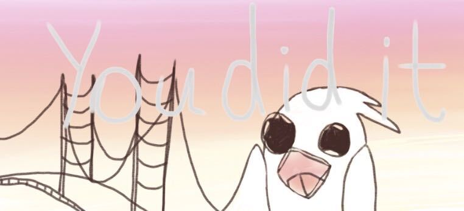

# Friendly Freeze

Friendly Freeze is a ragebait game made for Hack Club's Snowglobe program.

**Live Demo:** https://ragebait3erf.itch.io/ragebait-freeze

**Built By:** Prathika, Sushmita, Xinpei

Parthiki - Node structure and code/ music

Xinpei - Background, assets, and frames for FBF animations

Sushmita - Animations and code

## Description

The game was inspired by the theme "Freeze." It is a platformer game that is designed to make you mad. The background music is Tiki Tiki Phonk, designed to give players the boost of aura needed to complete the game! Good luck! If you beat this game, be proud of yourself! Even the creators can't beat it.

## How we built it

We used the game engine Godot for this project. For the script, we used Godot's GD Script language.

Templates/Tutorials/Resources we used:

https://www.figma.com/deck/OF7qJyZ1v7CMgvjFWW8vUE/Haven-Godot-Workshop
https://jams.hackclub.com/jam/godot-platformer

## what was hard, and how we fixed it
Adding the effects so the background looked far away, and making sure the game was difficult was pretty hard. We fixed it by watching a LOT of tuts on youtube, and searching the depths of reddit for answers.

…

## what's next
If we could add things to our game, we'd add lots of jumpscares and changes of music and different backgrounds and animations!
…
YAY: 

